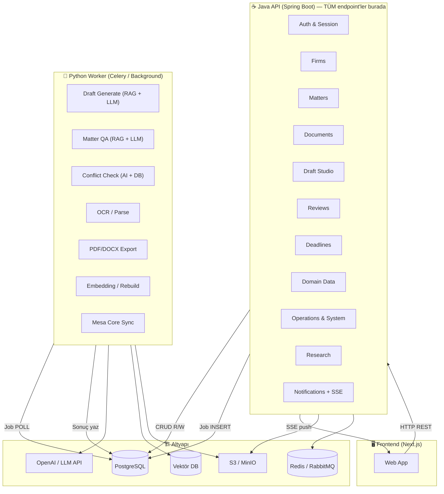
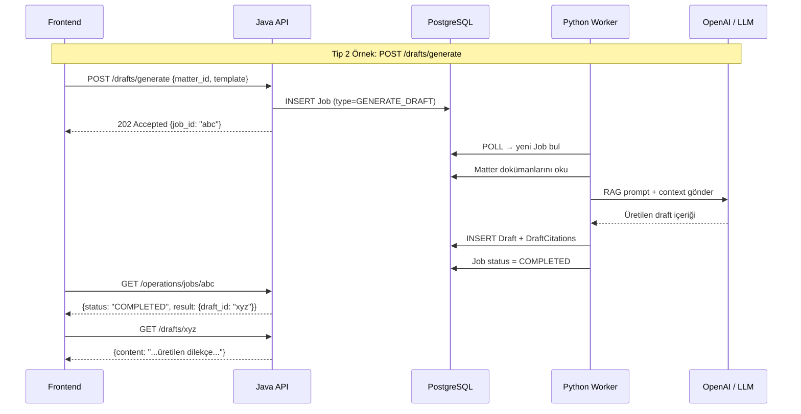
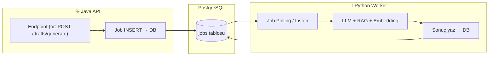

# MESA Law — Java + Python Hibrit Mimari Planı

Tüm endpoint'ler Java API'de olacak. Frontend **sadece Java API** ile konuşacak. LLM/AI gereken işlerde Java, Python'a iş delege edecek.

## Büyük Resim

## İletişim Modeli: 3 Tip Endpoint

### Tip 1: ☕ Saf Java (CRUD / İş Akışı)
Frontend → Java → DB → Java → Frontend. Python'a hiç dokunmaz.

### Tip 2: ☕→🐍 Java + Python Worker (Asenkron Job)
Frontend → Java (Job kaydı oluştur, DB'ye yaz) → Frontend'e `job_id` dön.
Python Worker arka planda Job'u alır → LLM/AI işini yapar → Sonucu DB'ye yazar.
Frontend `GET /operations/jobs/{id}` ile durumu polling yapar veya SSE ile dinler.

### Tip 3: ☕→🐍 Java + Python AI Service (Senkron HTTP)
Frontend → Java → Java Python'a **internal HTTP call** atar → Cevabı alır → Frontend'e döner.
(Bazı AI işleri çok hızlı olduğunda kullanılır, ör: conflict-check)

---

## Tüm Endpoint'lerin Sınıflandırması

### 1. Auth & Session & Users

| Endpoint | Tip | Açıklama |
|----------|-----|----------|
| `GET /users/me` | ☕ Java | Saf DB okuma |
| `PUT /users/me` | ☕ Java | Saf DB güncelleme |
| `POST /users/me/support-access` | ☕ Java | Saf DB yazma + audit log |
| `GET /session/context` | ☕ Java | Saf DB okuma |
| `POST /session/active-firm` | ☕ Java | Saf DB güncelleme |

> **AI gereksinimi: YOK.** Hepsi saf Java CRUD.

---

### 2. Firms

| Endpoint | Tip | Açıklama |
|----------|-----|----------|
| `GET /firms` | ☕ Java | Saf DB okuma |
| `POST /firms` | ☕ Java | Saf DB yazma |
| `GET /firms/{id}` | ☕ Java | Saf DB okuma |
| `GET /firms/members` | ☕ Java | Saf DB okuma |
| `PUT /firms/{id}/members/{uid}/role` | ☕ Java | Saf DB güncelleme |

> **AI gereksinimi: YOK.** Hepsi saf Java CRUD.

---

### 3. Matters

| Endpoint | Tip | Açıklama |
|----------|-----|----------|
| `GET /matters` | ☕ Java | Saf DB okuma |
| `POST /matters` | ☕ Java | Saf DB yazma |
| `GET /matters/{id}` | ☕ Java | Saf DB okuma |
| `GET /matters/{id}/parties` | ☕ Java | Saf DB okuma |
| `GET /matters/{id}/timeline` | ☕ Java | Saf DB okuma |
| `GET /matters/{id}/claims-evidence` | ☕ Java | Saf DB okuma |
| `GET /matters/{id}/evidence` | ☕ Java | Saf DB okuma |
| `POST /matters/conflict-check` | ☕→🐍 Senkron | Java → Python AI Service'e HTTP call. DB taraması + AI similarity check |
| `POST /matters/{id}/override-conflict` | ☕ Java | Saf DB yazma (risk kabul logu) |
| `POST /matters/{id}/qa` | ☕→🐍 Asenkron Job | Java Job oluşturur → Python Worker RAG+LLM ile cevap üretir |

> **AI gerektiren: 2 endpoint** — `conflict-check` (senkron/asenkron) ve `qa` (asenkron job).

---

### 4. Documents & Parser

| Endpoint | Tip | Açıklama |
|----------|-----|----------|
| `GET /documents` | ☕ Java | Saf DB okuma |
| `GET /documents/matters/{id}` | ☕ Java | Saf DB okuma |
| `GET /documents/{id}` | ☕ Java | Saf DB okuma (metadata) |
| `GET /documents/{id}/download` | ☕ Java | S3 presigned URL üret |
| `POST /documents/upload-intent` | ☕ Java | S3 presigned URL üret |
| `POST /documents/{id}/complete` | ☕→🐍 Asenkron Job | Java Job oluşturur → Python Worker OCR+Parse yapar |
| `GET /documents/{id}/viewer-context` | ☕ Java | Saf DB okuma (notlar, bounding box) |
| `GET /parsed/document/{id}` | ☕ Java | Saf DB okuma (parse sonucu) |
| `GET /parsed/{id}/pages` | ☕ Java | Saf DB okuma |

> **AI gerektiren: 1 endpoint** — `complete` (OCR/Parse Job'u tetikler, ama endpoint kendisi saf Java).

---

### 5. Draft Studio ⭐

| Endpoint | Tip | Açıklama |
|----------|-----|----------|
| `GET /drafts` | ☕ Java | Saf DB okuma (MatterMember JOIN) |
| `POST /drafts` | ☕ Java | Saf DB yazma |
| `GET /drafts/matters/{id}` | ☕ Java | Saf DB okuma |
| `GET /drafts/{id}` | ☕ Java | Saf DB okuma |
| `PUT /drafts/{id}` | ☕ Java | Saf DB güncelleme + revision |
| `GET /drafts/{id}/citations` | ☕ Java | Saf DB okuma |
| `POST /drafts/{id}/submit-review` | ☕ Java | Durum değişikliği (DRAFT→IN_REVIEW) |
| `POST /drafts/{id}/approve` | ☕ Java | Citation kontrolü + durum değişikliği |
| `POST /drafts/{id}/export` | ☕→🐍 Asenkron Job | Java Job oluşturur → Python Worker PDF/DOCX üretir |
| `POST /drafts/generate` | ☕→🐍 Asenkron Job | Java Job oluşturur → Python Worker RAG+LLM ile draft üretir |

> **AI gerektiren: 2 endpoint** — `generate` (LLM draft üretimi) ve `export` (PDF/DOCX dönüşümü). Ama ikisi de sadece Job oluşturup kuyruğa atar, endpoint'in kendisi saf Java.

---

### 6. Reviews

| Endpoint | Tip | Açıklama |
|----------|-----|----------|
| `GET /reviews` | ☕ Java | Saf DB okuma |
| `GET /reviews/matters/{id}` | ☕ Java | Saf DB okuma |
| `GET /reviews/{id}` | ☕ Java | Saf DB okuma |
| `GET /reviews/{id}/context` | ☕ Java | Saf DB okuma (matter özeti) |
| `POST /reviews/{id}/approve` | ☕ Java | Saf DB güncelleme |
| `POST /reviews/{id}/reject` | ☕ Java | Saf DB güncelleme |
| `POST /reviews/{id}/correct` | ☕ Java | Saf DB güncelleme |

> **AI gereksinimi: YOK.** Hepsi saf Java CRUD.

---

### 7. Deadlines

| Endpoint | Tip | Açıklama |
|----------|-----|----------|
| `GET /deadlines` | ☕ Java | Saf DB okuma |
| `POST /deadlines/{id}/complete` | ☕ Java | Saf DB güncelleme |

> **AI gereksinimi: YOK.**

---

### 8. Mesa Binding & Domain Data

| Endpoint | Tip | Açıklama |
|----------|-----|----------|
| `GET /domain_data/courts` | ☕ Java | Statik/DB okuma |
| `GET /matters/{id}/mesa-binding` | ☕ Java | Saf DB okuma |
| `PUT /matters/{id}/mesa-binding` | ☕ Java | Saf DB güncelleme |

> **AI gereksinimi: YOK.**

---

### 9. Operations & Audit & System

| Endpoint | Tip | Açıklama |
|----------|-----|----------|
| `GET /audit/events` | ☕ Java | Saf DB okuma |
| `GET /operations/jobs` | ☕ Java | Saf DB okuma (Job tablosu) |
| `GET /operations/metrics` | ☕ Java | Prometheus metrikleri |
| `GET /system/settings` | ☕ Java | Saf DB okuma |
| `PUT /system/settings` | ☕ Java | Saf DB güncelleme |
| `GET /system/dependencies` | ☕ Java | Health check (ping DB, Redis, S3) |
| `POST /system/sync-mesa-core` | ☕→🐍 Asenkron Job | Java Job oluşturur → Python Worker vektör indeksleri rebuild eder |
| `POST /matters/{id}/rebuild-mesa` | ☕→🐍 Asenkron Job | Java Job oluşturur → Python Worker embedding yeniler |

> **AI gerektiren: 2 endpoint** — `sync-mesa-core` ve `rebuild-mesa` (vektör DB işlemleri).

---

### 10. Research

| Endpoint | Tip | Açıklama |
|----------|-----|----------|
| `POST /research/start` | ☕→🐍 Asenkron Job | Java Job oluşturur → Python Worker RAG araması yapar |
| `GET /research/search` | ☕ Java | Saf DB okuma (önceki sonuçlar) |

> **AI gerektiren: 1 endpoint** — `research/start`.

---

### 11. Notifications

| Endpoint | Tip | Açıklama |
|----------|-----|----------|
| `GET /notifications` | ☕ Java | Saf DB okuma |
| `POST /notifications/{id}/read` | ☕ Java | Saf DB güncelleme |
| `GET /notifications/sse` | ☕ Java (SseEmitter) | Spring'in `SseEmitter` class'ı ile. Python'a gerek yok. |

> **AI gereksinimi: YOK.** SSE bile Java'da yapılabilir (Spring WebFlux veya SseEmitter ile).

---

## Genel Sayısal Özet

| Kategori | Endpoint Sayısı |
|----------|-----------------|
| ☕ **Saf Java** (CRUD / İş Akışı) | **~42** |
| ☕→🐍 **Java → Python Worker** (Asenkron Job) | **~8** |
| **TOPLAM** | **~50** |

> [!IMPORTANT]
> **Sonuç:** 50 endpoint'in **tamamı** Java API'de yazılacak. Python'a hiçbir endpoint doğrudan gitmeyecek. Sadece **8 endpoint** arka planda Python Worker'a iş delege edecek — ve bu delegasyon da sadece DB'ye bir `Job` kaydı INSERT etmekten ibaret.

## Java → Python İletişim Mekanizması

**Mekanizma çok basit:**
1. Java endpoint'i `jobs` tablosuna bir satır ekler (`type`, `payload`, `status=PENDING`)
2. Python Worker sürekli `jobs` tablosunu poll eder (veya Redis/RabbitMQ dinler)
3. Worker yeni job bulur → LLM/AI işini yapar → sonucu DB'ye yazar → `status=COMPLETED`
4. Frontend `GET /operations/jobs/{id}` ile durumu sorgular

> [!NOTE]
> Bu mimari zaten mevcut projede kullanılıyor (OCR/Parse, Export için). Yeni bir altyapı kurmana gerek yok — sadece yeni `Job` tipleri ekliyorsun.

## Python Worker'a Delege Edilen 8 İş

| Java Endpoint | Job Tipi | Python'da Yapılan İş |
|---------------|----------|----------------------|
| `POST /drafts/generate` | `GENERATE_DRAFT` | RAG + LLM ile dilekçe üretimi |
| `POST /drafts/{id}/export` | `EXPORT_DRAFT` | HTML → PDF/DOCX dönüşümü |
| `POST /documents/{id}/complete` | `PARSE_DOCUMENT` | OCR + metin çıkarma |
| `POST /matters/{id}/qa` | `MATTER_QA` | RAG + LLM ile soru-cevap |
| `POST /matters/conflict-check` | `CONFLICT_CHECK` | AI similarity + DB taraması |
| `POST /research/start` | `RESEARCH` | RAG ile içtihat araması |
| `POST /system/sync-mesa-core` | `SYNC_MESA` | Vektör indeksi rebuild |
| `POST /matters/{id}/rebuild-mesa` | `REBUILD_MESA` | Embedding yenileme |
